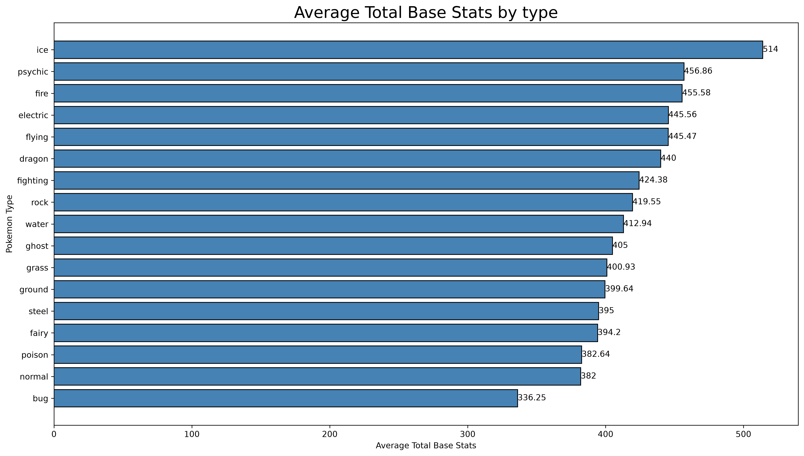
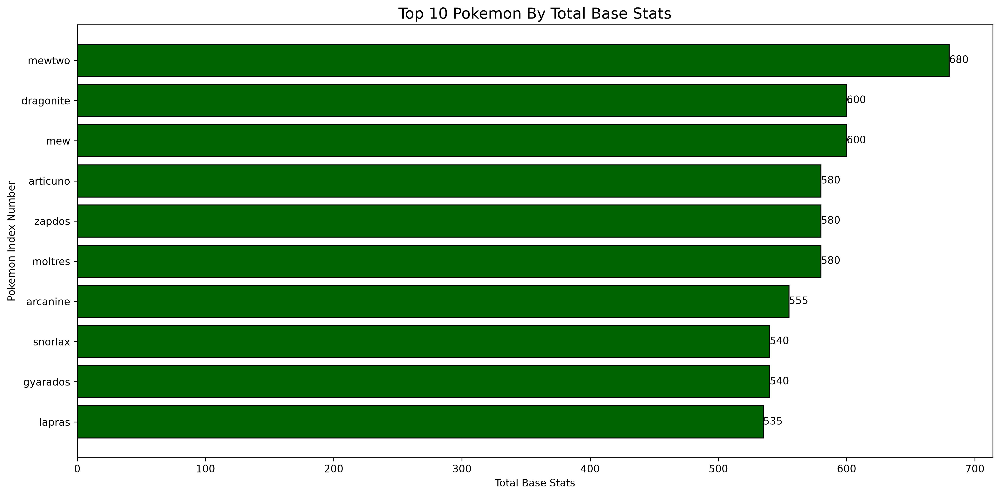
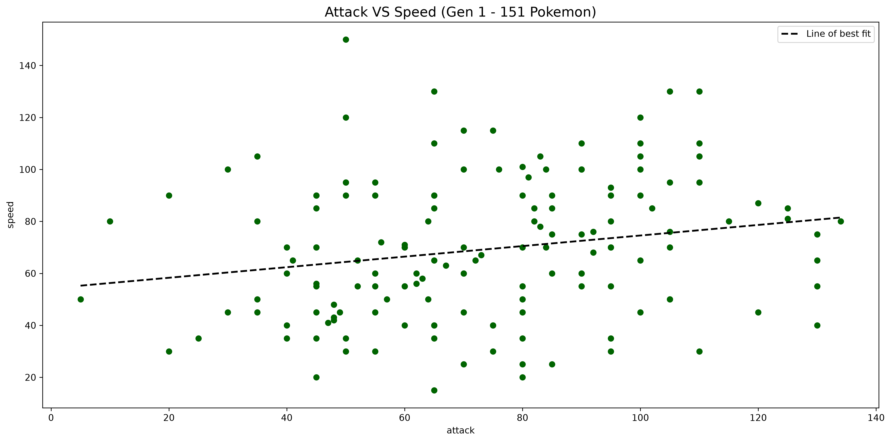

# Pokémon Generation 1 — Data Analysis Findings

## 1. Average Total Base Stats by Type

Findings (Analysis)

The ICE Pokémon have the highest average total base stats
of 514, whereas bug Pokémon have the lowest average.

However, the highest-ranked type contains only 5
Pokémon, which means its average may be heavily influenced
by a small sample size.

This suggests that comparing average base stats alone may
not provide a complete picture of the differences between
Pokémon types.

## 2. Top 10 Pokemon By Total Base Stats

Findings (Analysis)

The legendary bird trio all have a total base stat of 580.
I did not know this and was quite interesting.
All it means is that the developers tried their best to balance the legendary bird trio.
The highest base stat pokemon is MewTwo with a total base stat of 680.
Whilst the lowest in the top 10 is Lapras with 535.
This is a range of 145 in the top 10, which is a substantial range in terms of overall strength of the pokemon, 
purely based of stats. 
However, this data does not take their movesets or capabilities into account, therefore this may be misleading.

## 3. Attack Vs Speed (All Gen 1 Pokemon)

Findings(Analysis)

Do stronger physical attackers tend to be faster?

The Pearson Correlation Coefficient is +0.20123758233995542
This means that there is insignificant and inconsequential correlation between
attack and speed of a pokemon.
This means that stronger attackers don't tend to be faster than their counterparts.
However, there are a couple pokemon with very low speed and attack, but not the same extremity lies in high attack and speed,
the highest attack and speed a pokemon has (where both are high) is (110,130) whereas lowest is (20,30)

Are there Pokémon with exceptionally high Attack but low Speed?

There are several pokemon with exceptionally high attack but low speed,
likely skewing the correlation of the scatter graph.

Is the relationship strong enough to support a general conclusion?

No. It, such a low Pearson correlation coefficient does not indicate sufficient correlation.
The line of best fit along with the correlation coefficient confirms that there is a very slight positive 
linear relationship. I analyse this more in te last part of this analysis section.

Could particular Pokémon be influencing the correlation?

Yes, as there are extremes of exceptionally high attack pokemon with low speed,
but there are not pokemon with exceptionally high speed with low attack, skewing the data.
If we eliminated these so called 'Outliers', we would see a much higher correlation coefficient,
likely to do with the evolution of pokemon and thus their increasing base stats, furthermore the 
movement from starter pokemon and common pokemon to legendary and mythical pokemon (just mew in Gen 1),
with naturally increased base stats due to their rarity, as discused in '##2'

## SQL & Data Validation

The Generation 1 Pokémon dataset was validated by comparing analytical results produced independently using Pandas and SQLite.

Four checks were completed: total Pokémon count, average Attack by type, top 10 Pokémon rankings by total base stats, and the number of dual-type Pokémon.

All four checks produced matching results, confirming consistency between the Pandas and SQL analyses for these measures.